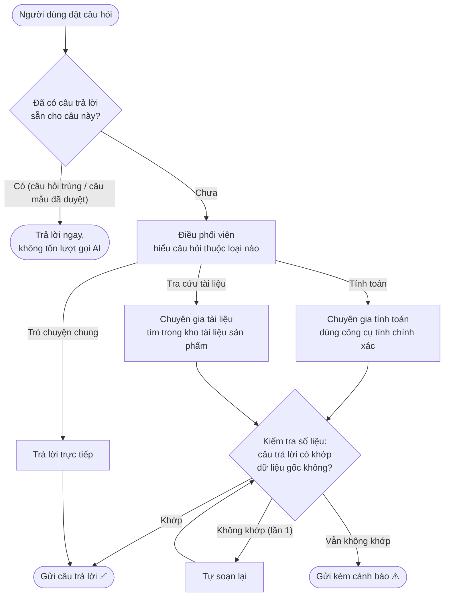

# Cloud Presales Agent

**Trợ lý AI cho đội presales cloud: tính chi phí, ước tính cấu hình và tra cứu tài liệu sản phẩm CMC Cloud, đồng thời tự kiểm tra từng con số trước khi đưa cho người dùng.**

---

## Dự án này giải quyết vấn đề gì?

Nhân viên presales phải trả lời khách hàng liên tục những câu giống nhau: *"Backup 500 GB mất bao lâu?"*, *"Ứng dụng 1.000 người dùng cần máy chủ cỡ nào?"*, *"Dịch vụ có cam kết SLA bao nhiêu?"*. Phần lớn câu trả lời là **con số sẽ đi thẳng vào báo giá**, nên sai một con số là mất uy tín.

Chatbot thông thường không giải quyết được việc này. Chúng **bịa số rất tự tin**, không phân biệt được câu hỏi tính toán với câu hỏi tra cứu, và không học được gì từ lỗi sai.

Dự án này xây một trợ lý khác ở 4 điểm:

| | Chatbot thông thường | Trợ lý này |
|---|---|---|
| Con số | Do AI "nghĩ ra" | Lấy từ **công cụ tính toán** hoặc **tài liệu thật**; AI không được tự đặt số |
| Kiểm tra | Không có | Mọi câu trả lời được **một AI khác đối chiếu với dữ liệu gốc** trước khi gửi đi |
| Khi không chắc | Vẫn trả lời như đúng | Nói rõ phần nào chưa xác minh được, kèm ⚠️ cảnh báo |
| Học từ lỗi | Không | Ghi nhớ các chỉnh sửa **đã được người duyệt** và áp dụng cho lần sau |

---

## Hệ thống hoạt động như thế nào?



Nói đơn giản:

1. **Kiểm tra xem đã có câu trả lời sẵn chưa.** Câu hỏi giống hệt câu đã hỏi trước đó, hoặc trùng với một câu hỏi thường gặp đã được người duyệt soạn sẵn, sẽ được trả lời ngay mà không tốn chi phí AI.
2. **Hiểu yêu cầu.** Một "điều phối viên" xác định câu hỏi cần **tính toán**, cần **tra tài liệu**, hay chỉ là **trò chuyện**, rồi chuyển cho đúng chuyên gia.
3. **Làm việc bằng dữ liệu thật.** Chuyên gia tính toán dùng công thức lập trình sẵn, nên không bao giờ "đoán" số. Chuyên gia tài liệu tìm đúng đoạn tài liệu liên quan và trích nguồn.
4. **Tự kiểm tra.** Một AI độc lập đối chiếu từng con số, tên dịch vụ và điều khoản trong câu trả lời với dữ liệu gốc. Nếu không khớp, hệ thống tự sửa một lần; vẫn không khớp thì gửi kèm cảnh báo, **không bao giờ âm thầm đưa số sai**.
5. **Hiển thị minh bạch.** Câu trả lời hiện ra từng chữ ngay khi được viết. Bên cạnh có khung **"Nhật ký hệ thống"** giải thích bằng lời dễ hiểu hệ thống đang làm gì: đã hiểu yêu cầu ra sao, dùng công cụ nào, kiểm tra số liệu ra sao, mất bao lâu.
6. **Học từ góp ý.** Người dùng bấm 👎 và ghi thông tin đúng; sau khi người duyệt xác nhận, hệ thống áp dụng chỉnh sửa đó cho các câu hỏi tương tự về sau.

---

## Những gì dự án đã làm được

Mọi con số dưới đây đều được **đo trên hệ thống thật**, không phải ước đoán.

**🎯 Tìm đúng tài liệu**
- Tỷ lệ tìm đúng đoạn tài liệu ngay ở kết quả đầu tiên tăng từ **26,7% lên 83,3%**. Tìm đúng trong 4 kết quả đầu tăng từ **28,3% lên 96,7%** (đo ngày 21/11 trên 60 câu hỏi).
- Hiểu chữ viết tắt (KMS → Key Management Service) và có thêm kênh tìm theo từ khóa cho mã sản phẩm và con số chính xác. Trên bộ câu khó (viết tắt, tên sản phẩm, gõ không dấu), hệ thống tìm đúng **100%** trong 4 kết quả đầu.
- Có bước chấm lại độ liên quan, nhờ đó câu hỏi không có trong tài liệu sẽ được trả lời trung thực là "chưa có dữ liệu", thay vì kéo về một đoạn không liên quan.

**✅ Độ tin cậy của câu trả lời**
- Công cụ tính toán được sửa các lỗi **tính sai nhưng không báo** (sai đơn vị, nhận nhầm gói lưu trữ, không chặn giá trị vô lý).
- Mọi câu trả lời cần dữ liệu đều được kiểm tra chéo; câu chưa kiểm chứng được thì gắn cảnh báo bằng tiếng Việt.
- Câu hỏi hỏi lại người dùng ("Bạn cho mình biết dung lượng dữ liệu nhé?") không bị gắn cảnh báo sai.

**⚡ Nhanh hơn, rẻ hơn**
- Câu hỏi trùng: **0 lượt gọi AI, khoảng 0,005 giây**, so với 5 lượt gọi và 7,6 giây ở lần hỏi đầu.
- Bộ **câu trả lời mẫu đã được duyệt** cho các câu hỏi thường gặp: trả lời ngay, không tốn chi phí AI, và người dùng không phân biệt được với câu trả lời thường.
- Câu trả lời bắt đầu hiện chỉ sau khoảng **4 giây**, thay vì phải đợi toàn bộ quá trình xử lý xong.
- Dùng các mô hình AI **miễn phí**. Chúng được chọn qua benchmark: điều phối viên phân loại đúng 100% câu hỏi thử nghiệm. Khi một mô hình hết hạn mức, hệ thống tự chuyển sang mô hình dự phòng.

**🔒 An toàn**
- Mọi truy cập đều cần khóa API, có giới hạn số lần gọi để chống lạm dụng.
- Dữ liệu trên cơ sở dữ liệu được khóa, chỉ backend truy cập được.
- Góp ý của người dùng phải được **người duyệt xác nhận** mới được dùng, để không ai "dạy sai" được hệ thống.
- Có kiểm thử chống tấn công chèn lệnh (prompt injection) qua nội dung góp ý.

**🧠 Ghi nhớ hội thoại**
- Hiểu câu hỏi nối tiếp ("còn tier Archive thì sao?").
- Tải lại trang vẫn giữ nguyên cuộc trò chuyện.

**🧪 Chất lượng phần mềm**
- **316 kiểm thử tự động**, chạy trong khoảng 8 giây, không cần mạng.
- Có bộ đánh giá end-to-end, bộ đánh giá riêng cho AI kiểm tra số liệu, và trang **Dashboard chất lượng** để theo dõi.

---

## Công nghệ sử dụng

| Thành phần | Công nghệ | Vai trò |
|---|---|---|
| Điều phối các tác tử AI | LangGraph | Chuyển câu hỏi qua điều phối viên → chuyên gia → kiểm tra |
| Mô hình ngôn ngữ | Groq (GPT-OSS 120B / 20B, Qwen3.8), Gemini (dự phòng) | Hiểu câu hỏi, viết câu trả lời, kiểm tra |
| Hiểu nghĩa văn bản | Qwen3-Embedding-0.6B (chạy trên máy) | Tìm tài liệu theo nghĩa |
| Chấm độ liên quan | BGE-reranker-v2-m3 (chạy trên máy) | Chọn đúng đoạn tài liệu |
| Cơ sở dữ liệu | Supabase (PostgreSQL + pgvector) | Tài liệu, hội thoại, góp ý, câu trả lời mẫu |
| Bộ nhớ đệm | Redis | Câu hỏi trùng không tốn chi phí |
| Backend / Giao diện | FastAPI / Streamlit | API có streaming; giao diện chat tiếng Việt và dashboard |

---

## Dành cho kỹ thuật viên

### Cài đặt và chạy

Cần: Python 3.12+, [uv](https://docs.astral.sh/uv/), [Groq API key](https://console.groq.com/keys) miễn phí, một [Supabase project](https://app.supabase.com) và Docker (cho Redis, tùy chọn).

```bash
uv venv --python python3.12 .venv && source .venv/bin/activate
uv pip sync requirements.lock            # đúng phiên bản đã kiểm thử
cp .env.example .env                     # điền GROQ_API_KEY, SUPABASE_URL, SUPABASE_SECRET_KEY, API_KEYS, ADMIN_API_KEY
```

**Cơ sở dữ liệu:** trong Supabase SQL Editor, chạy lần lượt `sql/schema.sql`, `sql/seed_data.sql`, rồi các file trong `sql/migrations/` theo thứ tự số. Lệnh `python -m app.db.run_migration` in sẵn toàn bộ SQL. Dùng **secret key** (`sb_secret_…`); anon key bị RLS chặn.

```bash
python -m scripts.ingest_files ./docs --category Feature     # nạp tài liệu PDF / DOCX / TXT / MD
docker run -d --name presales-redis --restart unless-stopped -p 127.0.0.1:6379:6379 redis:7-alpine   # tùy chọn: cache
bash scripts/dev.sh                                            # chạy backend :8000 + giao diện :8501
```

Mở giao diện tại **http://localhost:8501** và tài liệu API tại **http://localhost:8000/docs**.

### Cấu hình chính (`.env`, xem đủ trong `.env.example`)

| Biến | Ý nghĩa |
|---|---|
| `LLM_MODELS`, `SUPERVISOR_MODELS`, `GRADER_MODELS` | Chuỗi mô hình theo vai trò, dạng `provider:model` (`groq`, `gemini:`, `hf:`); thiếu key thì mô hình đó bị bỏ qua |
| `API_KEYS`, `ADMIN_API_KEY` | Khóa truy cập (`label:key`); server không khởi động nếu thiếu |
| `RERANK_MIN_SCORE` | Ngưỡng độ liên quan của tài liệu (0.1, **chưa hiệu chỉnh**; xem `docs/retrieval-quality.md`) |
| `HYBRID_SEARCH_ENABLED` | Bật kênh tìm theo từ khóa (cần migration 004) |
| `REDIS_URL`, `ANSWER_CACHE_TTL_SECONDS` | Cache câu hỏi trùng (mặc định 24 giờ; Redis lỗi thì vẫn chạy bình thường) |
| `CANNED_ANSWERS_ENABLED`, `CANNED_MIN_SIMILARITY` | Câu trả lời mẫu đã duyệt (ngưỡng khớp 0.90) |

### API

| Method | Path | Mô tả |
|---|---|---|
| `GET` | `/health` | Trạng thái backend và cơ sở dữ liệu |
| `POST` | `/chat` | `{"query", "session_id"?}` → `{"route", "response", "ragas"}` |
| `POST` | `/chat/stream` | SSE: `progress` → `ttft` → `token`… (`reset` khi tự soạn lại) → `ragas` → `final` (văn bản chính thức, kèm cảnh báo nếu có) |
| `GET` | `/history?session_id=` | Lịch sử một cuộc trò chuyện (tách riêng theo API key) |
| `POST` | `/feedback` | Góp ý 👍/👎; chỉnh sửa ở trạng thái chờ duyệt |
| `GET` / `POST` | `/admin/feedback`, `/admin/feedback/{id}/review` | Duyệt góp ý (cần admin key); duyệt xong thì xóa cache |

Mọi endpoint trừ `/health` đều cần header `X-API-Key`.

### Quản lý câu trả lời mẫu

```bash
python -m scripts.canned_answers draft                      # hệ thống tự soạn bản nháp cho danh sách FAQ (chưa dùng)
python -m scripts.canned_answers list --status draft
python -m scripts.canned_answers show <id>                  # đọc kỹ trước khi duyệt
python -m scripts.canned_answers approve <id> --reviewer "Tên" --days 90
python -m scripts.canned_answers disable <id>
```

Một câu mẫu chỉ được dùng khi độ tương đồng ≥ 0.90 **và** các con số cùng tên sản phẩm khớp chính xác ("10GB" ≠ "100GB", "ELB của AWS" ≠ "ELB").

### Kiểm thử và đánh giá

```bash
python -m evals.audit --refresh                  # KIỂM TOÁN TOÀN HỆ THỐNG: 6 tầng, điểm 0–100, giám khảo AI độc lập (Gemini)
python -m pytest -q                              # 316 test, không cần mạng (Groq / Supabase / Redis / model đều được giả lập)
python -m evals.eval_e2e                         # đánh giá end-to-end offline; thêm --live để chạy mô hình thật
python -m scripts.eval_retrieval_production      # đo độ chính xác truy xuất trên DB thật
python -m scripts.eval_lexical_stress            # câu hỏi có viết tắt / tên sản phẩm / không dấu
python -m scripts.eval_orchestrator --models groq:qwen/qwen3.8-27b   # benchmark mô hình điều phối
python -m scripts.calibrate_retrieval reviewed.json --out calib.json # hiệu chỉnh ngưỡng trên dữ liệu đã gán nhãn
```

Chi tiết: [`evals/README.md`](evals/README.md) (bộ đánh giá, dashboard) và [`docs/retrieval-quality.md`](docs/retrieval-quality.md) (truy xuất, ngưỡng, cách hiệu chỉnh).

### Cấu trúc thư mục

```
app/
  main.py                 API (FastAPI): chat, streaming, góp ý, lịch sử, admin
  graph/                  LangGraph: điều phối viên (supervisor), luồng xử lý, state
  agents/                 Chuyên gia tính toán và tài liệu, dùng chung vòng gọi công cụ (tool_agent.py)
  graders/                AI kiểm tra số liệu (Grounding Grader)
  tools/                  Công cụ tính toán, tìm tài liệu, reranker, bộ nhớ hội thoại và góp ý
  retrieval/              Tìm kiếm lai (vector + từ khóa), chữ viết tắt, hiệu chỉnh ngưỡng
  cache.py · canned.py    Cache Redis cho câu hỏi trùng · câu trả lời mẫu đã duyệt
  llm.py · config.py      Chuỗi mô hình có dự phòng · cấu hình
  security.py             Khóa API, giới hạn số lần gọi
  observability.py        Log có request id, số token, độ trễ
ui/                       Giao diện Streamlit: chat + nhật ký hệ thống, dashboard chất lượng
scripts/                  Nạp tài liệu, câu trả lời mẫu, các benchmark
evals/                    Bộ đánh giá end-to-end, AI kiểm tra số liệu, RAGAS
sql/                      Schema, dữ liệu mẫu, migrations
tests/                    316 test
```

### Hạn chế hiện tại

- **Kho tài liệu chưa có tài liệu SLA, bảo mật và tuân thủ chính thức.** Câu hỏi về các chủ đề này sẽ được trả lời là "chưa có dữ liệu".
- **`RERANK_MIN_SCORE` chưa được hiệu chỉnh** trên bộ câu hỏi đã gán nhãn. Điểm reranker là độ liên quan, không phải xác suất câu trả lời đúng.
- **Cache và câu trả lời mẫu không tự cập nhật khi tài liệu thay đổi.** Nên đặt hạn dùng, hoặc xóa thủ công khi nạp lại tài liệu.
- **Chưa hỗ trợ so sánh với đối thủ:** tính năng này đã được gỡ bỏ, nên những câu hỏi đó được trả lời là không hỗ trợ.
